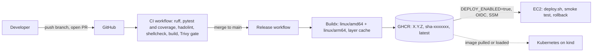
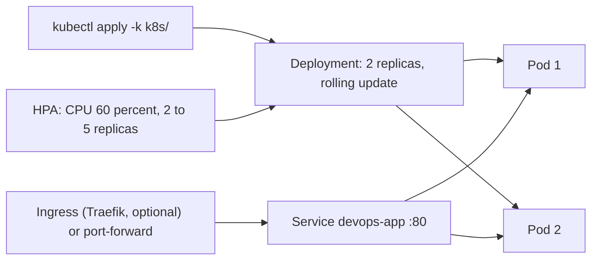
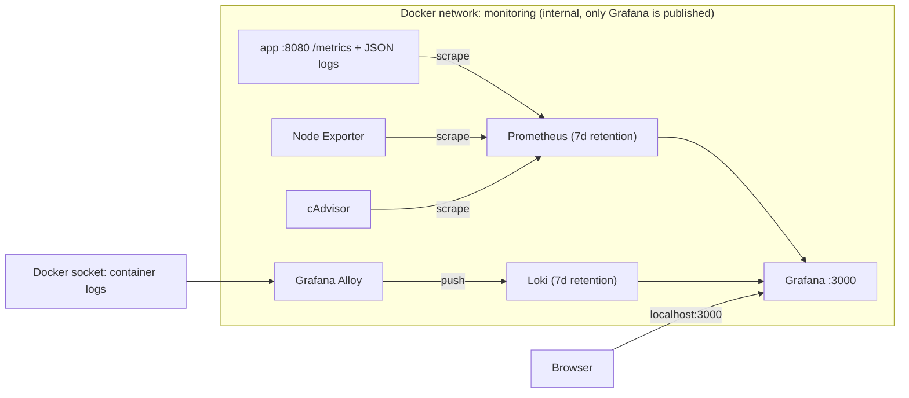

# DevOps Task: Build, Ship, Deploy and Monitor a Small Web Service

A small FastAPI service taken from source code to a containerized, tested, scanned, observable and Kubernetes-deployable state.

> **Search for `TODO` in this file.** Each one is a value or screenshot that only exists on the author's machine (image size, coverage number, screenshots, command output). Fill them in before submitting.

## Table of contents

1. [Project status and scope](#1-project-status-and-scope)
2. [Repository layout](#2-repository-layout)
3. [Architecture](#3-architecture)
4. [Prerequisites](#4-prerequisites)
5. [Run the app locally](#5-run-the-app-locally)
6. [Run the tests](#6-run-the-tests)
7. [CI/CD pipelines](#7-cicd-pipelines)
8. [Kubernetes deployment](#8-kubernetes-deployment)
9. [Observability stack](#9-observability-stack)
10. [Health check script](#10-health-check-script)
11. [Terraform](#11-terraform)
12. [Design decisions](#12-design-decisions)
13. [Deployment and rollback strategy](#13-deployment-and-rollback-strategy)
14. [Security considerations](#14-security-considerations)
15. [Rough monthly AWS cost estimate](#15-rough-monthly-aws-cost-estimate)
16. [What I would improve with more time](#16-what-i-would-improve-with-more-time)
17. [Use of AI tools](#17-use-of-ai-tools)

---

## 1. Project status and scope

I have **no AWS account**, so everything that needs AWS could not be executed. I chose to say so plainly instead of presenting untested code as working.

| Step | Area | Status |
|---|---|---|
| 1 | Application, tests, Dockerfile, docker-compose | Done and verified locally |
| 2 | GitHub Actions: PR checks, multi-arch build, registry push | Done (GHCR registry) |
| 2 | Deploy to EC2 over SSM with automatic rollback | **Written, not executed** (needs AWS). Disabled by default. The deploy and rollback logic (`scripts/deploy.sh`) is plain Docker and can be run locally |
| 3 | Terraform (EC2, IAM, CloudWatch, S3 remote state) | **TODO: not included in this version.** Update section 11 when it is added |
| 4 | Kubernetes on kind: 2 replicas, probes, HPA, rolling update, rollback | Done and verified locally |
| 5 | Observability: Prometheus, Grafana, Loki, Alloy, Node Exporter, cAdvisor | Done and verified locally |
| 6 | `system_health.sh` with systemd timer | Done and verified locally |
| 7 | This README | Done |

---

## 2. Repository layout

```
devops-task/
├── app/
│   ├── __init__.py
│   ├── main.py                    # FastAPI service: /, /health, /metrics
│   ├── healthcheck.py             # Used by the Docker HEALTHCHECK
│   ├── requirements.txt
│   ├── requirements-dev.txt
│   └── tests/test_main.py
├── Dockerfile
├── .dockerignore
├── docker-compose.yaml            # App only
├── docker-compose.monitoring.yaml # Prometheus, Grafana, Loki, Alloy, Node Exporter, cAdvisor
├── .env.example
├── VERSION                        # Semantic version used for image tags
├── .github/
│   ├── dependabot.yaml
│   └── workflows/
│       ├── ci.yaml                # PR checks (also reusable)
│       └── main.yaml              # Release pipeline
├── k8s/
│   ├── kind-config.yaml
│   ├── namespace.yaml
│   ├── configmap.yaml
│   ├── secret.example.yaml        # Template only, real secret is never committed
│   ├── deployment.yaml
│   ├── service.yaml
│   ├── hpa.yaml
│   ├── ingress.yaml
│   └── kustomization.yaml
├── monitoring/
│   ├── prometheus/{prometheus.yaml, alerts.yaml}
│   ├── loki/loki-config.yaml
│   ├── alloy/config.alloy
│   └── grafana/
│       ├── provisioning/{datasources, dashboards}/
│       └── dashboards/{app-overview, host-overview, containers-overview}.json
├── scripts/
│   ├── system_health.sh
│   ├── system-health.service
│   ├── system-health.timer
│   ├── deploy.sh                  # Deploy, smoke test, automatic rollback
│   └── pin-actions.sh             # Pins GitHub Actions to commit SHAs
├── docs/screenshots/
└── README.md
```

---

## 3. Architecture

### 3.1 Code to registry to deployment



### 3.2 Kubernetes flow



### 3.3 Observability: how metrics and logs reach Grafana



---

## 4. Prerequisites

| Tool | Used for |
|---|---|
| Docker (with Compose v2) | App, monitoring stack, kind |
| Python 3.12 | Running tests and linting locally |
| Git | Source control |
| `kind` and `kubectl` | Local Kubernetes |
| `shellcheck` | Linting shell scripts |
| `jq` (optional) | Reading the health script's JSON |
| Helm (optional) | Installing the Traefik ingress controller |

Developed on Windows 11 with WSL2 (Ubuntu) and Docker Desktop. Note that on Docker Desktop the "host" that Node Exporter sees is Docker's Linux VM, not Windows.

---

## 5. Run the app locally

### 5.1 Configuration

```bash
cp .env.example .env
# Edit .env and set GRAFANA_ADMIN_PASSWORD
```

| Variable | Default | Purpose |
|---|---|---|
| `PORT` | `8080` | Port the app listens on |
| `LOG_LEVEL` | `INFO` | Log verbosity |
| `ENVIRONMENT` | `local` | Environment name (appears in every log line) |
| `APP_VERSION` | from Docker build arg | Version reported by `/` |
| `ENABLE_FAULT_INJECTION` | `false` | Adds a `/boom` endpoint that returns 500, for the observability demo only |
| `GRAFANA_ADMIN_USER` / `GRAFANA_ADMIN_PASSWORD` | none | Grafana login. Compose refuses to start if they are missing |

`.env` is ignored by Git and Docker. Only `.env.example` is committed.

### 5.2 App only

```bash
docker compose up -d --build
docker compose ps                 # wait for "healthy"
curl localhost:8080/
curl localhost:8080/health
curl localhost:8080/metrics | head
docker compose stop               # sends SIGTERM, then check the logs for the graceful shutdown message
docker compose logs app | tail -5
```

### 5.3 App plus the full monitoring stack

```bash
docker compose -f docker-compose.yaml -f docker-compose.monitoring.yaml up -d --build
docker compose -f docker-compose.yaml -f docker-compose.monitoring.yaml ps
```

Open Grafana at <http://localhost:3000> and log in with the credentials from `.env`. The dashboards are in the folder **DevOps Task**. All other monitoring components are only reachable inside the Docker network.

Generate some traffic so the panels have data:

```bash
for i in $(seq 1 300); do curl -s localhost:8080/ >/dev/null; curl -s localhost:8080/health >/dev/null; sleep 0.1; done
```

### 5.4 Image facts

- Final image size: **TODO** (run `docker images devops-task:0.1.0` and paste the SIZE).
- Base: `python:3.12.16-alpine3.24`, multi-stage, runs as UID 10001, with a HEALTHCHECK and OCI labels.

---

## 6. Run the tests

```bash
python3 -m venv .venv
source .venv/bin/activate
pip install -r app/requirements-dev.txt
ruff check app
pytest app/tests --cov=app --cov-report=term-missing
```

Test coverage at the time of writing: **TODO** (paste the total from the pytest output).

---

## 7. CI/CD pipelines

### 7.1 Pull requests: `.github/workflows/ci.yaml`

Three parallel jobs run on every pull request to `main`:

| Job | What it does |
|---|---|
| Lint, test and coverage | `ruff`, `pytest` with coverage, coverage table in the run summary, `coverage.xml` uploaded as an artifact |
| Dockerfile and shell lint | `hadolint` on the Dockerfile, `shellcheck` on `scripts/*.sh` |
| Build image and scan | Builds the image with layer caching, then Trivy: an informational HIGH/CRITICAL report, then a gate that **fails the build on CRITICAL** |

### 7.2 Push to `main`: `.github/workflows/main.yaml`

1. Re-runs the same CI checks (reusable workflow), so nothing is published unless they pass.
2. Builds a **multi-architecture** image (`linux/amd64` and `linux/arm64`) with GitHub Actions layer caching, plus an SBOM and build provenance attestation.
3. Tags it with the semantic version from the `VERSION` file, the commit SHA, and `latest` (as a convenience only).
4. Pushes to **GitHub Container Registry** using the built-in `GITHUB_TOKEN`, so no secret is configured.
5. Smoke-tests the pushed image by running it and calling `/health`.
6. **Deploy job (disabled by default):** assumes an AWS role through GitHub OIDC and runs `scripts/deploy.sh` on the EC2 instance through SSM. It only runs when the repository variable `DEPLOY_ENABLED` is `true`. **It was not executed** because I have no AWS account.

### 7.3 Secrets and variables

| Name | Type | Needed for | Notes |
|---|---|---|---|
| `GITHUB_TOKEN` | automatic | Pushing to GHCR | Nothing to configure |
| `DEPLOY_ENABLED` | repository variable | Turning on the deploy job | Leave unset |
| `AWS_ROLE_ARN`, `AWS_REGION`, `EC2_INSTANCE_ID` | repository variables | Deploy job only | No access keys anywhere, OIDC only |

No secrets are hardcoded. If the GHCR package is private, make it public (or give the EC2 host a pull token) before deploying.

### 7.4 Evidence

- PR checks passing: **TODO** (`docs/screenshots/ci-checks.png`)
- Release run and the package with its three tags: **TODO** (`docs/screenshots/release-run.png`)

### 7.5 Local proof of the deploy and rollback logic

`scripts/deploy.sh` replaces the running container, polls `/health`, and if the check never passes it removes the failed container and restarts the previous image. It can be exercised without AWS:

```bash
export CONTAINER_NAME=deploy-demo HOST_PORT=8090 SMOKE_DELAY=2 SMOKE_RETRIES=10
./scripts/deploy.sh devops-task:0.1.0     # first deploy
./scripts/deploy.sh devops-task:0.2.0     # upgrade
printf 'FROM alpine:3.21\nCMD ["sleep","infinity"]\n' | docker build -t devops-task:broken -
./scripts/deploy.sh devops-task:broken; echo "exit code: $?"   # expect rollback to 0.2.0, exit code 1
docker rm -f deploy-demo
```

Output of the rollback run: **TODO** (paste it here once it has run cleanly).

---

## 8. Kubernetes deployment

Local cluster with `kind` (v0.33.0). Manifests are in `k8s/` and applied with Kustomize.

### 8.1 What the manifests configure

| Requirement | Where |
|---|---|
| 2 replicas, rolling update with `maxSurge: 1`, `maxUnavailable: 0` | `deployment.yaml` |
| Liveness and readiness probes on `/health` | `deployment.yaml` |
| CPU and memory requests and limits | `deployment.yaml` |
| Non-root, read-only root filesystem, no privilege escalation, all capabilities dropped | `deployment.yaml` |
| `preStop` sleep so the Service stops routing before the app gets SIGTERM | `deployment.yaml` |
| Service | `service.yaml` |
| Ingress (Traefik, optional) | `ingress.yaml` |
| ConfigMap for configuration | `configmap.yaml` |
| Secret for sensitive values | Created from the command line, template in `secret.example.yaml` |
| HorizontalPodAutoscaler (CPU 60 percent, 2 to 5 replicas) | `hpa.yaml` |

### 8.2 Deploy

```bash
dc stop 2>/dev/null || true      # optional: free resources by stopping the Compose stack
kind create cluster --config k8s/kind-config.yaml
kind load docker-image devops-task:0.1.0 --name devops

kubectl apply -f k8s/namespace.yaml
kubectl -n devops create secret generic devops-app-secret --from-literal=API_KEY="$(openssl rand -hex 16)"
kubectl apply -k k8s/
kubectl -n devops rollout status deployment/devops-app
kubectl -n devops get pods,svc,hpa
```

Access the app with a port-forward (the documented alternative to an Ingress):

```bash
kubectl -n devops port-forward svc/devops-app 8082:80
curl localhost:8082/
```

### 8.3 Secrets approach

The real Secret is created with `kubectl create secret` from a randomly generated value. It is **never written to a file in the repository**. `k8s/secret.example.yaml` only documents the name and keys, and `k8s/secret.yaml` is in `.gitignore` as a guardrail in case someone creates a local copy. Kubernetes Secrets are base64-encoded, not encrypted, so for production see section 8.7.

### 8.4 Security context proof

```bash
POD=$(kubectl -n devops get pod -l app=devops-app -o jsonpath='{.items[0].metadata.name}')
kubectl -n devops exec "$POD" -- id                    # uid=10001
kubectl -n devops exec "$POD" -- touch /test.txt       # Read-only file system
```

### 8.5 Autoscaling

metrics-server is installed with `--kubelet-insecure-tls`, which is acceptable for kind's self-signed kubelet certificates and **not** acceptable in production.

```bash
kubectl apply -f https://github.com/kubernetes-sigs/metrics-server/releases/latest/download/components.yaml
kubectl patch -n kube-system deployment metrics-server --type=json \
  -p '[{"op":"add","path":"/spec/template/spec/containers/0/args/-","value":"--kubelet-insecure-tls"}]'
kubectl top pods -n devops
kubectl -n devops get hpa
```

### 8.6 Zero-downtime rolling update and rollback

```bash
# Build and load a new version
docker build -t devops-task:0.2.0 --build-arg APP_VERSION=0.2.0 .
kind load docker-image devops-task:0.2.0 --name devops

# Terminal 1: continuous traffic through the Service
kubectl -n devops run probe --rm -i --restart=Never --image=curlimages/curl:latest --command -- \
  sh -c 'while true; do curl -s --max-time 2 -w " HTTP %{http_code}\n" http://devops-app/; sleep 0.3; done'

# Terminal 2: roll out
kubectl -n devops set image deployment/devops-app app=devops-task:0.2.0
kubectl -n devops annotate deployment/devops-app kubernetes.io/change-cause="update to 0.2.0" --overwrite
kubectl -n devops rollout status deployment/devops-app
kubectl -n devops rollout history deployment/devops-app

# Roll back
kubectl -n devops rollout undo deployment/devops-app
kubectl -n devops rollout status deployment/devops-app
```

Why it is zero-downtime: with `maxUnavailable: 0`, Kubernetes starts a new pod and waits for its readiness probe before stopping an old one, so two ready pods are always serving.

Command output and the version switching from 0.1.0 to 0.2.0 with every line still `HTTP 200`: **TODO** (paste the output here).

### 8.7 How this would change on EKS for production

- **Ingress:** the AWS Load Balancer Controller creating an ALB, with TLS certificates from ACM, instead of a NodePort mapping.
- **Secrets:** AWS Secrets Manager through External Secrets Operator or the Secrets Store CSI driver, with KMS encryption of etcd.
- **Images:** pushed to a registry such as ECR and pulled by immutable tag or digest, instead of `kind load`.
- **Node autoscaling:** Karpenter or Cluster Autoscaler so the HPA can actually obtain nodes.
- **IAM:** IAM Roles for Service Accounts (or EKS Pod Identity), so pods get least-privilege AWS access without static keys.
- **Resilience:** multi-AZ node groups, topology spread constraints, a PodDisruptionBudget and NetworkPolicies.
- **metrics-server:** proper kubelet certificates, without `--kubelet-insecure-tls`.

### 8.8 Optional Ingress with Traefik

The classic `ingress-nginx` controller reached end of maintenance in March 2026, so I did not build on it. `k8s/ingress.yaml` targets Traefik, installed with Helm:

```bash
helm repo add traefik https://traefik.github.io/charts && helm repo update
helm install traefik traefik/traefik -n traefik --create-namespace \
  --set service.type=NodePort --set ports.web.nodePort=30080
curl -i http://devops.localtest.me:8081/
```

---

## 9. Observability stack

All six mandatory components run from `docker-compose.monitoring.yaml`, with pinned versions: Prometheus v3.15.1, Grafana 13.3.0, Loki 3.7.9, Alloy v1.21.1, Node Exporter v1.12.1, cAdvisor v0.60.6.

### 9.1 Metrics

Prometheus scrapes the app (`/metrics`), Node Exporter (host) and cAdvisor (containers) every 15 seconds. Retention is explicit: **7 days or 2 GB**, whichever comes first.

### 9.2 Logs and label choices

Grafana Alloy discovers every container through the Docker socket and ships logs to Loki, which keeps them for **7 days** (compactor retention). The app's JSON logs are parsed in Alloy.

| Field | Handling | Reason |
|---|---|---|
| `container`, `service` | Loki labels | A few dozen values at most |
| `level` | Loki label | About 4 values, the most common filter |
| `path`, `method`, `status` | Structured metadata, not labels | Filterable (`\| status=~"5.."`) without creating a new stream per value |

Every distinct label combination creates a separate Loki stream, so labels must stay low-cardinality. Request IDs, user IDs and timestamps are never used as labels. The app also records the route template (`/health`) instead of the raw URL in its metrics, for the same reason.

### 9.3 Dashboards (provisioned from files, never created in the UI)

| Dashboard | Contents |
|---|---|
| **Application Overview** | Request rate, error rate (with the 5 percent line), latency p50/p95/p99, 5xx by path, and **Loki log panels in the same view**, so an error spike can be investigated next to its metrics |
| **Host Overview** | CPU, memory, disk (80 percent line) and network from Node Exporter |
| **Containers Overview** | Per-container CPU and memory from cAdvisor, and memory as a percentage of each container's configured limit |

Screenshots:


**TODO:** make sure these three files exist in `docs/screenshots/`.

### 9.4 Alerting rules and thresholds

Rules are in `monitoring/prometheus/alerts.yaml`.

| Alert | Condition | `for` | Why this threshold |
|---|---|---|---|
| `AppInstanceDown` | `up == 0` | 1m | At a 15s scrape interval that is about 4 missed scrapes. It ignores a quick restart but still alerts within about a minute and a half. Critical, because users are affected. |
| `AppHighErrorRate` | 5xx above 5 percent of requests, only when traffic is above 0.1 req/s | 5m | 5 percent is clearly abnormal. The traffic floor stops 1 failure in 2 requests from alerting at night. 5 minutes filters short blips. |
| `AppHighLatencyP95` | p95 above 500 ms | 10m | Slow but working is less urgent than down, so the window is longer. 500 ms is an example SLO to tune. |
| `HostDiskUsageHigh` | Any real filesystem above 80 percent | 10m | Disks fill slowly, so 80 percent leaves time to act. |
| `ContainerMemoryNearLimit` | Working set above 90 percent of the container limit | 5m | Above 90 percent the container is close to being OOM-killed. 5 minutes avoids reacting to short spikes. Containers without a limit are ignored, which avoids dividing by zero. |

### 9.5 Walkthrough: "An error spike appears on the Application dashboard. How do you find the cause?"

1. **Confirm and time-box it.** On Application Overview the error-rate panel crosses its red 5 percent line. Drag across the spike on the graph, which zooms every panel, including the logs, to that window.
2. **Find what is failing.** The "5xx errors by path" panel shows which endpoint produces the errors (in the fault-injection test, `/boom`).
3. **Read the evidence.** The error-log panel, now filtered to the spike, shows the failing requests (`status: 500`) and the `ERROR` entries with the exception message and traceback. This gives the cause, not just the symptom.
4. **Rule infrastructure in or out.** Open Containers Overview and Host Overview for the same time range. If the app's memory approached its limit, CPU was pinned or the disk was full, the cause is resource pressure. If they are flat, it is application code.
5. **Pivot in Explore if needed**, for example `sum by (path) (count_over_time({service="app"} | status=~"5.." [1m]))`, or search for a message with `{service="app"} |= "simulated failure"`.
6. **Fix and verify.** Roll back or fix, then watch the error rate return to 0 percent and the alert resolve.

Screenshot of an investigated spike: **TODO** (`docs/screenshots/error-investigation.png`).

To reproduce a spike, set `ENABLE_FAULT_INJECTION=true` in `.env`, restart the app, and run:

```bash
for i in $(seq 1 80); do curl -s localhost:8080/boom >/dev/null; sleep 0.25; done
```

### 9.6 Hygiene and security

- **Credentials:** Grafana's admin user and password come from `.env` (`${VAR:?message}` makes Compose refuse to start without them). Nothing is hardcoded.
- **Exposure:** only Grafana publishes a port (3000). Prometheus, Loki, Alloy, Node Exporter and cAdvisor live on an internal Docker network. The app keeps port 8080 because the task requires it.
- **Versions:** every image is pinned.
- **Resource limits** are set on every service, which is what makes the "memory versus limit" dashboard and alert work for all of them.

Mounts and privileges granted:

| Component | Access granted | Why |
|---|---|---|
| Node Exporter | Host `/` mounted **read-only** at `/host`, `pid: host` | Reads the host's filesystems and processes. No privileged mode, no extra capabilities. `rslave` propagation was **not** used because Docker Desktop on WSL2 has no shared root mount and refuses to start the container. On a Linux server, `/:/host:ro,rslave` is the recommended form. |
| cAdvisor | Read-only `/`, `/sys`, `/var/lib/docker`, `/dev/disk`, `/var/run`. **`privileged: true`** and `/dev/kmsg` | Reads container cgroup statistics and OOM events. This is the largest privilege in the stack. |
| Alloy | `/var/run/docker.sock` (read-only mount) | Lists containers and reads their logs. A read-only socket mount does **not** limit the Docker API, so this is effectively root-equivalent. In production a docker-socket-proxy should sit in front. |

**Known trade-off:** Node Exporter stays on the bridge network so port 9100 is not published. As a result its network panel shows the exporter container's own traffic, not the host NIC's. Host-network mode would fix that but would publish port 9100 and break the "only Grafana is exposed" rule.

---

## 10. Health check script

`scripts/system_health.sh` collects CPU, memory, disk usage for every real mounted filesystem, load average and the top 5 processes by memory. It appends a timestamped entry to a log file, prints `[WARNING]` or `[CRITICAL]` lines when thresholds are exceeded, and returns an exit code that monitoring tools can use.

```bash
./scripts/system_health.sh --help
./scripts/system_health.sh                                        # text, logs to ./health_log.txt
./scripts/system_health.sh --json | jq .                          # JSON output
./scripts/system_health.sh --cpu 90 --mem 85 --disk 80            # custom thresholds
./scripts/system_health.sh --log-file /tmp/health_log.txt --max-size-kb 1024
```

| Exit code | Meaning |
|---|---|
| 0 | Healthy |
| 1 | Warning: a value is at or above its threshold |
| 2 | Critical: a value is at or above threshold + 10 (capped at 100) |
| 3 | Usage or runtime error (my addition, so a typo is never mistaken for "healthy") |

Design notes:
- `set -euo pipefail`, and it passes `shellcheck` with no warnings (also enforced in CI).
- CPU is measured from two `/proc/stat` samples one second apart. Memory uses `MemAvailable`, not "free" memory.
- Virtual filesystems (tmpfs, squashfs, overlay) are excluded so they cannot trigger false disk alarms.
- Log rotation: when the file exceeds `--max-size-kb`, it is rotated and 3 old files are kept.
- In `--json` mode, stdout stays pure JSON and warnings also go to stderr.

Run it every 5 minutes with systemd:

```bash
sudo install -m 0755 scripts/system_health.sh /usr/local/bin/system_health.sh
sudo cp scripts/system-health.service scripts/system-health.timer /etc/systemd/system/
sudo systemctl daemon-reload
sudo systemctl enable --now system-health.timer
systemctl list-timers system-health.timer
```

Or with cron:

```
*/5 * * * * /usr/local/bin/system_health.sh --log-file /var/log/health_log.txt >/dev/null 2>&1
```

Evidence of the exit codes and log rotation (terminal output): **TODO** (paste it or add a screenshot).

---

## 11. Terraform

**Status: TODO. Not included in this version.** I have no AWS account, so I could not run `terraform apply`. When added, this section will cover the code layout, `terraform fmt` and `terraform validate` results, and a clear statement that it was not applied.

The design this section will describe:
- EC2 instance in the default VPC with a security group exposing only the required ports.
- An IAM instance profile with minimum permissions (write CloudWatch Logs, SSM access), no static keys.
- User data that installs Docker and runs the container.
- CloudWatch Logs with a defined retention period.
- Remote state in S3 with locking.
- Variables so the same code provisions staging and production.

---

## 12. Design decisions

| Decision | Choice | Reason and trade-off |
|---|---|---|
| Language and framework | Python FastAPI | Small, fast to write and test, and the Prometheus client library is mature. |
| Base image | `python:3.12-alpine` (pinned) | Small and shell-capable, which allows a Python-based HEALTHCHECK with no extra packages. Distroless is smaller and has no shell (a smaller attack surface), but it makes debugging and the HEALTHCHECK harder. Alpine uses musl, so a native-extension dependency could need extra work. |
| Deployment target | EC2 for the single-service case, Kubernetes demonstrated locally | EC2 is the simplest thing that works for one container. ECS/Fargate removes server management and would be my next step. EKS adds a control plane cost and operational load that one small service does not justify. |
| Registry | GHCR | Free, built into GitHub, and authenticated with the workflow token, so no secret is needed. |
| Tagging | `X.Y.Z` from the `VERSION` file, `sha-<commit>`, and `latest` | The commit SHA tag is unique and is what deploys use. The semantic version marks releases and is bumped by editing `VERSION`. `latest` exists only as a convenience and is never what a deployment relies on. Until `VERSION` is bumped, the same semantic tag is re-pointed on each push, which is a known limit. |
| Secrets | No secrets in the repository. `GITHUB_TOKEN` for the registry, OIDC for AWS, `.env` (ignored) for Compose, `kubectl create secret` for Kubernetes | Nothing sensitive ever lands in Git history. |
| Multi-arch builds | QEMU emulation on a standard runner | One simple job. Native ARM runners would be faster. |
| Trivy gate | Fail on CRITICAL, with `ignore-unfixed: true` | A CRITICAL finding with no available patch cannot be acted on. The HIGH and CRITICAL report is still shown for visibility. |
| Supply chain | Third-party actions pinned to full commit SHAs, Dependabot for updates, `trivy-action` v0.36.0 | In March 2026 the Trivy action's version tags were force-pushed to malicious code. Tags can be rewritten, commit SHAs cannot. |
| Loki version | 3.7.9 (stable) | Loki 4.0 was still a release candidate when this was built. |
| Log labels | `container`, `service`, `level` only | Keeps Loki's index small. See section 9.2. |
| Retention | 7 days for metrics and logs | Enough for debugging a recent incident without filling a laptop disk. |
| Ingress | Traefik (optional) and a port-forward | `ingress-nginx` is no longer maintained. |

---

## 13. Deployment and rollback strategy

**How a release reaches production safely**

1. Work happens on a branch and enters `main` only through a pull request that passes lint, tests, Dockerfile and shell lint, and the Trivy gate.
2. A merge to `main` re-runs those checks, then builds and publishes the multi-arch image with an immutable `sha-<commit>` tag and a version tag.
3. The published image is smoke-tested before anything deploys it.
4. The deploy step (disabled here) assumes an AWS role through OIDC and has the instance run `deploy.sh` with the SHA-tagged image.
5. `deploy.sh` replaces the container and polls `/health`.

**How rollback works**

- **EC2 and Docker:** if the smoke test fails, `deploy.sh` removes the failed container and starts the previous image automatically. It exits non-zero so the pipeline fails visibly. To roll back manually, run `deploy.sh` with an earlier `sha-` tag. Every earlier image is still in the registry.
- **Kubernetes:** `kubectl rollout undo deployment/devops-app`. The update itself is safe by construction, because with `maxUnavailable: 0` a new pod must pass its readiness probe before an old one is removed.

**Known limitation:** with a single container on a single port, `deploy.sh` has a few seconds of downtime during the swap. Blue/green behind a load balancer would remove it.

---

## 14. Security considerations

- **Secrets management:** none in Git. `.env`, `health_log.txt` and `k8s/secret.yaml` are ignored. CI uses the built-in token, and AWS access uses short-lived OIDC credentials, not stored keys. Kubernetes Secrets are not encrypted at rest by default, so production should use an external secret manager.
- **Image scanning:** Trivy runs on every pull request and fails on CRITICAL. The release build also produces an SBOM and a provenance attestation. Actions are pinned to commit SHAs and updated by Dependabot.
- **Container hardening:** multi-stage minimal image, non-root numeric UID 10001, read-only root filesystem (writable `/tmp` only), no privilege escalation, all Linux capabilities dropped, resource limits, and a HEALTHCHECK.
- **IAM (planned for the Terraform step):** an instance profile limited to writing CloudWatch Logs and SSM, with no static keys, and a GitHub OIDC role limited to the one deploy action.
- **Network exposure:** locally only Grafana (3000) and the app (8080) are published. Monitoring services sit on an internal Docker network. In AWS only the application port would be open, with administration through SSM rather than SSH.
- **Elevated access in the monitoring stack:** documented in section 9.6. cAdvisor is privileged and Alloy reads the Docker socket. Both are accepted for a local setup and should be hardened in production.

---

## 15. Rough monthly AWS cost estimate

**Assumptions:** `us-east-1`, on-demand pricing, one small instance per environment, 8 GB of storage, about 1 GB of logs a month. These are estimates, so verify with the AWS Pricing Calculator.

| Item | Production (about) |
|---|---|
| EC2 `t3.micro` (730 h) | $7.60 |
| EBS gp3 8 GB | $0.65 |
| Public IPv4 address | $3.65 |
| CloudWatch Logs (1 GB ingested plus storage) | $0.55 |
| S3 Terraform state, requests and storage | under $0.10 |
| SSM, data transfer within the free allowance | $0 |
| **Total** | **about $13 per month** |

- Staging and production together: about **$25 to $30** per month.
- Adding an Application Load Balancer for zero-downtime deploys and TLS: about **$16 to $20** more per month.
- Running the monitoring stack on AWS would need a larger instance or a managed service, and would be the main cost driver.

---

## 16. What I would improve with more time

- Complete the Terraform step, apply it on a real AWS account and capture the evidence for the EC2 deploy and rollback.
- Zero-downtime deploys on EC2 with blue/green behind an Application Load Balancer (or move to ECS Fargate).
- Alertmanager with routing to Slack or Discord, so the alert rules page someone.
- Image signing with Cosign, and verifying signatures at deploy time.
- A docker-socket-proxy for Alloy, and non-privileged cAdvisor where the platform allows it.
- Native ARM runners for faster multi-arch builds.
- Automated semantic versioning (for example, release tags driven by conventional commits) instead of editing `VERSION` by hand.
- Distributed tracing with OpenTelemetry and Grafana Tempo.
- A Helm chart with separate staging and production values, and the monitoring stack on Kubernetes with kube-prometheus-stack.
- A coverage threshold in CI, and integration tests that run against the built container.

---

## 17. Use of AI tools

I used an AI assistant (Claude) as a tutor and code generator during this task. It drafted code, configuration and explanations step by step, and it helped me diagnose errors from my own terminal output (for example a missing image tag, a `rslave` mount error on Docker Desktop, a file-extension mismatch in bind mounts, and a deploy script smoke-test failure). I ran and checked the results myself, and I read the code so that I can explain every part of this submission.

**TODO:** edit this paragraph so it accurately reflects what you did, and be ready to explain any file in the repository.